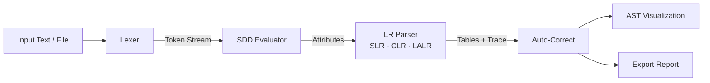

<div align="center">


<br/>


**A browser-based spell and grammar analyzer that treats English as a formal language and checks it with real compiler phases.**

[Overview](#-overview) · [Features](#-features) · [Pipeline](#-compiler-pipeline) · [Run](#-how-to-run) · [Algorithms](#-algorithms) · [Concepts](#-academic-concepts)

</div>

---

## 📌 Overview

**CompilerSpell** bridges compiler design theory and natural language processing.

Instead of a plain dictionary lookup, it models English text as a **formal grammar** and pushes it through the same phases a compiler uses:

| Phase | Compiler meaning | CompilerSpell meaning |
|---|---|---|
| Lexical analysis | Source code → tokens | Text → `WORD`, `NUMBER`, `PUNCT`, `WS`, `NL` |
| SDD | Attribute evaluation | Accuracy, error count, suggestions |
| LR parsing | Shift / reduce | Checks sentence structure with SLR, CLR, LALR |
| Code generation | Emit target code | Emit the auto-corrected text |
| AST | Parse tree | Visual tree of the document |

> *"Every sentence is a program. Every word is a token. Every error is a parse conflict."*

---

## 🔄 Compiler Pipeline

<div align="center">

</div>



---

## 🚀 Features

<table>
<tr>
<td width="50%" valign="top">

### 🧠 Compiler Core
- Four techniques: **SDD, SLR(1), CLR(1), LALR(1)**
- Custom lexer / tokenizer
- Attribute grammar evaluation
- ACTION / GOTO tables and parse trace
- FIRST / FOLLOW sets and LR(0) item sets

</td>
<td width="50%" valign="top">

### ✍️ Spell Intelligence
- Trie-based dictionary lookup
- Levenshtein distance for corrections
- Soundex phonetic matching
- Auto-correct that preserves capitalization

</td>
</tr>
<tr>
<td width="50%" valign="top">

### 📐 Grammar Rule Checker
- Double spaces and double punctuation
- Punctuation spacing
- Duplicate words
- Lowercase "i"
- Sentence capitalization
- Article misuse (a / an)
- Missing commas

</td>
<td width="50%" valign="top">

### 🖥️ Interface
- AST (parse tree) visualization
- File upload support
- Export analysis report
- **Zero dependencies**: pure HTML, CSS, JS

</td>
</tr>
</table>

---

## ⚙️ How to Run

Run these in a terminal (Git Bash, PowerShell, or macOS/Linux Terminal). You should see the repo folder appear after `git clone`.

```bash
git clone https://github.com/your-username/compilerspell.git
cd compilerspell
```

Then open `index.html`:

| OS | Command |
|---|---|
| macOS | `open index.html` |
| Linux | `xdg-open index.html` |
| Windows | `start index.html` |

Or just double-click `index.html`. No build step, no install.

---

## 📋 Usage

1. **Enter** text or upload a file
2. **Choose** a parsing technique (SDD, SLR, CLR, LALR)
3. Click **COMPILE**
4. **Inspect** the results: errors, suggestions, tokens, corrected output, parse tables, AST

---

## 🧠 Compiler Phases in Detail

### 1. Lexical Analysis
Breaks the input into tokens: `WORD`, `NUMBER`, `PUNCT`, `WS` (whitespace), `NL` (newline).

### 2. Syntax-Directed Definition (SDD)

```
G = (N, Σ, P, S)

Document → Sentence+
Sentence → Word+ Punctuation
Word     → CorrectWord | ErrorWord
```

Attributes computed: **accuracy**, **error count**, **suggestions**, **corrections**.

### 3. LR Parsing (SLR / CLR / LALR)
ACTION / GOTO tables, FIRST / FOLLOW sets, LR(0) item sets, and a step-by-step parse trace simulation.

### 4. Code Generation (Auto-Correct)
Applies corrections automatically, preserves capitalization, and keeps the original text structure.

---

## 🧩 Algorithms

| Algorithm | Used for |
|---|---|
| Trie | Fast dictionary lookup |
| Levenshtein distance | Ranking spelling corrections |
| Soundex | Phonetic matching ("fone" → "phone") |
| LR parsing (SLR, CLR, LALR) | Structural checking of sentences |
| FIRST & FOLLOW | Building parse tables |

---

## 🎓 Academic Concepts

- Formal grammar `G = (N, Σ, P, S)`
- Lexical analysis
- Syntax-directed definitions
- LR parsing: SLR, CLR, LALR
- FIRST / FOLLOW sets
- Parse trees and AST

---

## 📂 Project Structure

```
compilerspell/
├── index.html
├── README.md
└── assets/
    ├── logo.svg
    ├── banner(2).svg
    └── pipeline.svg
```

---

<div align="center">


*Every sentence is a program. Every word is a token. Every error is a parse conflict.*

⭐ If this helped you understand compilers, star the repo.

</div>
